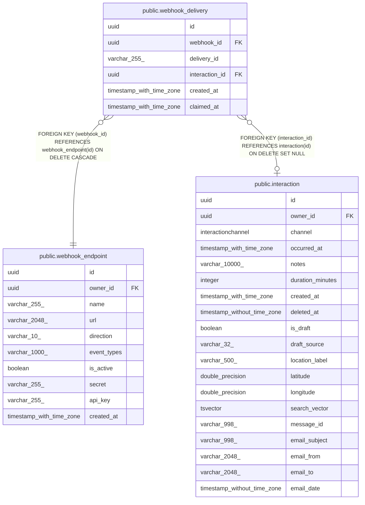

# public.webhook_delivery

## Columns

| Name | Type | Default | Nullable | Children | Parents | Comment |
| ---- | ---- | ------- | -------- | -------- | ------- | ------- |
| id | uuid |  | false |  |  |  |
| webhook_id | uuid |  | false |  | [public.webhook_endpoint](public.webhook_endpoint.md) |  |
| delivery_id | varchar(255) |  | false |  |  |  |
| interaction_id | uuid |  | true |  | [public.interaction](public.interaction.md) |  |
| created_at | timestamp with time zone | now() | false |  |  |  |
| claimed_at | timestamp with time zone | now() | false |  |  |  |

## Constraints

| Name | Type | Definition |
| ---- | ---- | ---------- |
| webhook_delivery_claimed_at_not_null | n | NOT NULL claimed_at |
| webhook_delivery_created_at_not_null | n | NOT NULL created_at |
| webhook_delivery_delivery_id_not_null | n | NOT NULL delivery_id |
| webhook_delivery_id_not_null | n | NOT NULL id |
| webhook_delivery_webhook_id_not_null | n | NOT NULL webhook_id |
| webhook_delivery_interaction_id_fkey | FOREIGN KEY | FOREIGN KEY (interaction_id) REFERENCES interaction(id) ON DELETE SET NULL |
| webhook_delivery_webhook_id_fkey | FOREIGN KEY | FOREIGN KEY (webhook_id) REFERENCES webhook_endpoint(id) ON DELETE CASCADE |
| webhook_delivery_pkey | PRIMARY KEY | PRIMARY KEY (id) |
| uq_webhook_delivery_event | UNIQUE | UNIQUE (webhook_id, delivery_id) |

## Indexes

| Name | Definition |
| ---- | ---------- |
| webhook_delivery_pkey | CREATE UNIQUE INDEX webhook_delivery_pkey ON public.webhook_delivery USING btree (id) |
| uq_webhook_delivery_event | CREATE UNIQUE INDEX uq_webhook_delivery_event ON public.webhook_delivery USING btree (webhook_id, delivery_id) |
| ix_webhook_delivery_webhook_id | CREATE INDEX ix_webhook_delivery_webhook_id ON public.webhook_delivery USING btree (webhook_id) |

## Relations

---

> Generated by [tbls](https://github.com/k1LoW/tbls)
